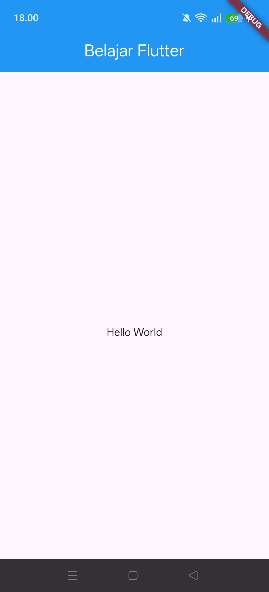
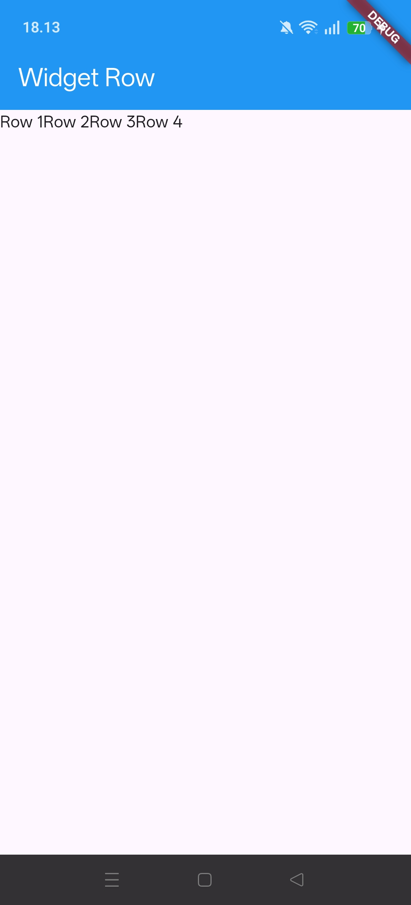

# Praktikum Pemrograman Mobile - Flutter

## Identitas

- **Nama:** Nalendra Wicaksana
- **NIM:** H1D024073
- **Shift Lama:** E
- **Shift Baru:** D

# Penjelasan Hasil Penugasan

## Pertemuan 8: Implementasi Struktur Data Queue (Antrean) di Dart

Kode pada `queue.dart` mengimplementasikan kelas generik `Queue<T>` dengan memanfaatkan `List` bawaan Dart sebagai media penyimpanan. Berikut adalah fungsi utama di dalamnya:

1. **`enqueue(T element)`**
   Menambahkan data baru pada posisi paling belakang antrean.

2. **`pop()` / Dequeue**
   Mengambil sekaligus menghapus data yang berada di posisi paling depan (indeks ke-0). Jika antrean kosong, fungsi akan mengembalikan nilai `null`.

3. **`isEmpty`**
   Properti *getter* untuk mengecek apakah antrean sedang kosong.

4. **`length`**
   Properti *getter* untuk mengetahui jumlah elemen yang ada di dalam antrean.

Berdasarkan fungsi `main()` di dalam kode, berikut adalah contoh proses antrean yang terjadi:

```
Queue<String> antreanPelanggan = Queue<String>();

// 1. Memasukkan data ke dalam antrean (Enqueue)
antreanPelanggan.enqueue("Nalendra");
antreanPelanggan.enqueue("Wicaksana");
antreanPelanggan.enqueue("H1D024073");

// Isi antrean saat ini: [Nalendra, Wicaksana, H1D024073]

// 2. Mengeluarkan data dari antrean (Pop)
antreanPelanggan.pop(); // "Nalendra" keluar karena pertama kali masuk
// Isi antrean tersisa: [Wicaksana, H1D024073]

antreanPelanggan.pop(); // "Wicaksana" keluar
// Isi antrean tersisa: [H1D024073]

```

## Pertemuan 9: Belajar Membuat Aplikasi Menggunakan Flutter

Berikut adalah hasil tampilan aplikasi yang dibuat menggunakan Flutter:

| Hasil Tampilan | Hasil Tampilan |
|---|---|
| **Hello World**<br> | **Widget Column**<br> |
| **Widget Row**<br> | **Form Produk**<br> |
| **List Produk**<br> | **Detail Produk**<br> |

Berdasarkan hasil tampilan di atas, aplikasi menampilkan teks sederhana menggunakan widget `Text`, menyusun widget secara vertikal dengan `Column` dan horizontal dengan `Row`, serta mengelola data produk melalui form, daftar, dan halaman detail.
