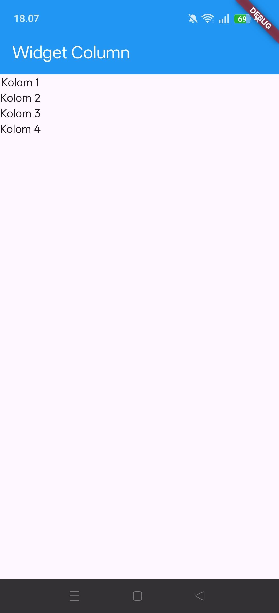
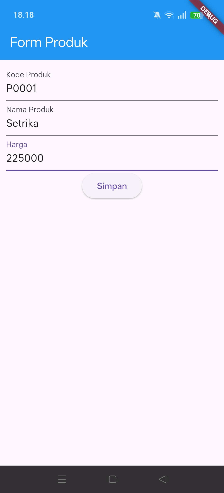
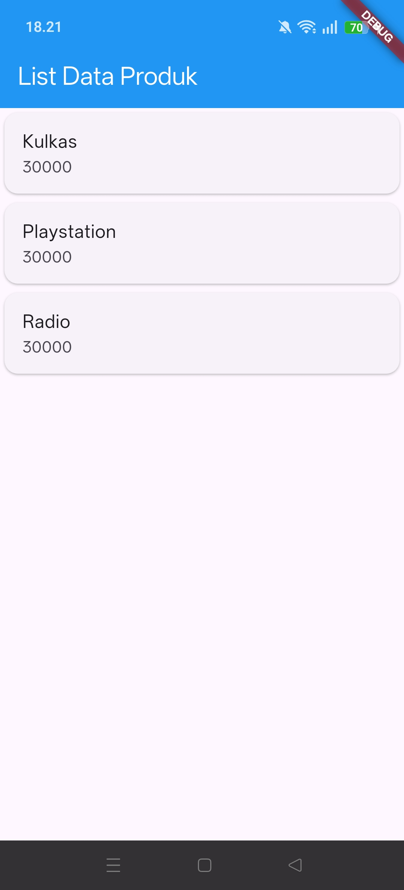
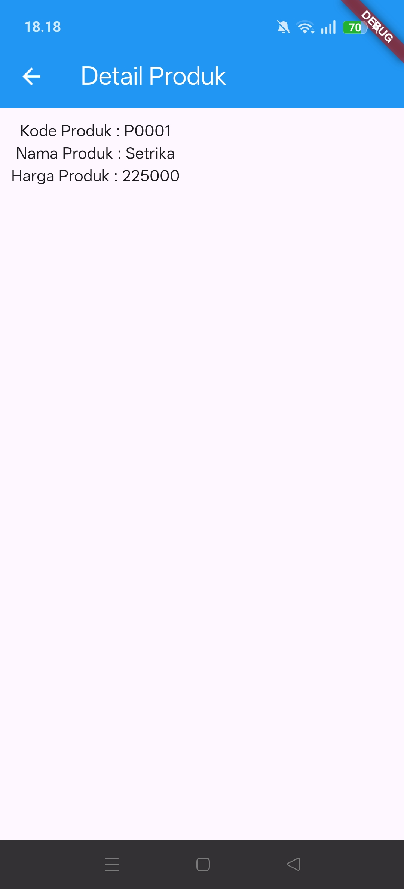
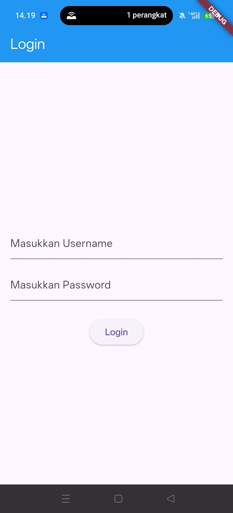
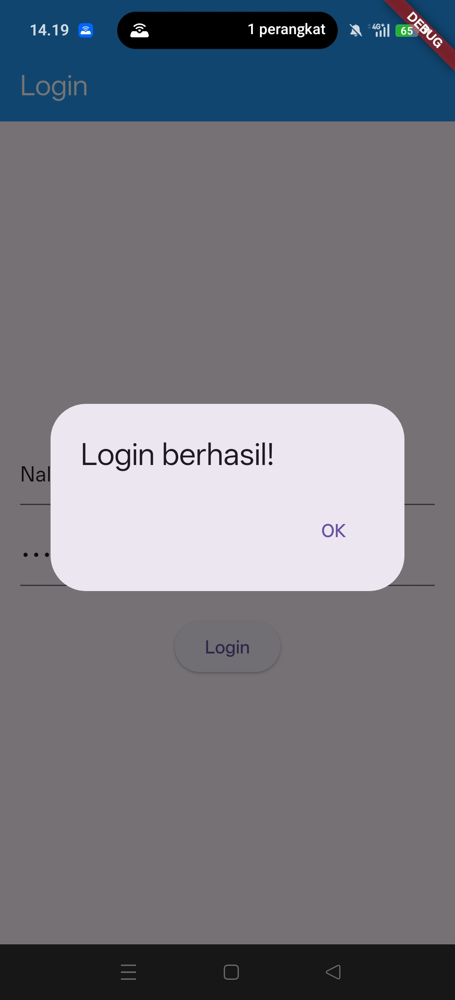
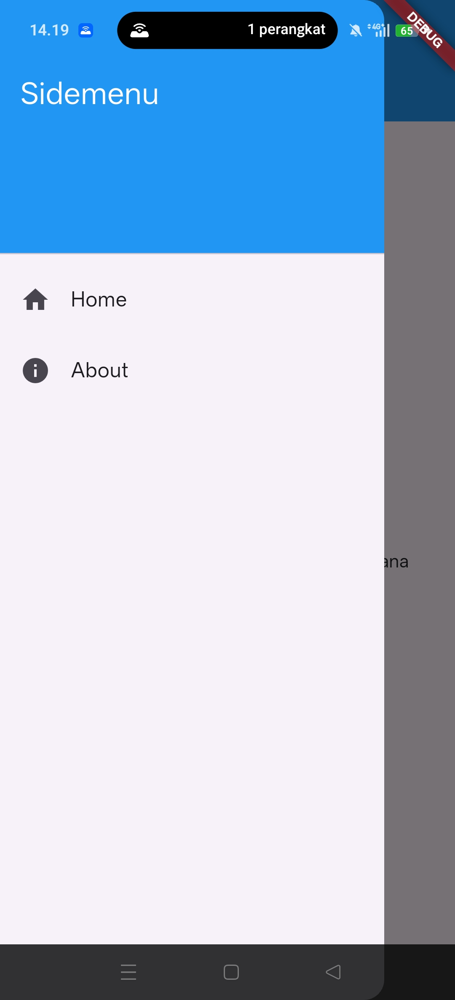
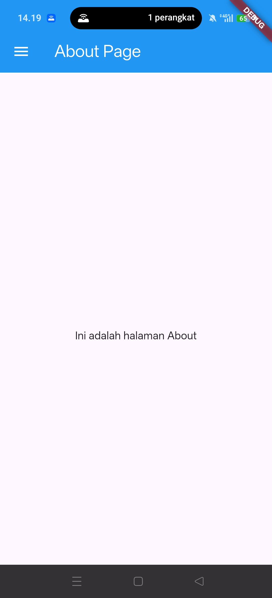
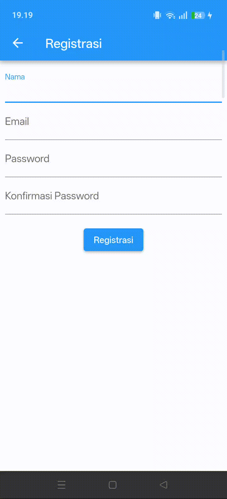

# Praktikum Pemrograman Mobile - Flutter

## Identitas

- **Nama:** Nalendra Wicaksana
- **NIM:** H1D024073
- **Shift Lama:** E
- **Shift Baru:** D

# Penjelasan Hasil Penugasan

## Pertemuan 8: Implementasi Struktur Data Queue (Antrean) di Dart

Kode pada `queue.dart` mengimplementasikan kelas generik `Queue<T>` dengan memanfaatkan `List` bawaan Dart sebagai media penyimpanan. Berikut adalah fungsi utama di dalamnya:

1. **`enqueue(T element)`**
   Menambahkan data baru pada posisi paling belakang antrean.

2. **`pop()` / Dequeue**
   Mengambil sekaligus menghapus data yang berada di posisi paling depan (indeks ke-0). Jika antrean kosong, fungsi akan mengembalikan nilai `null`.

3. **`isEmpty`**
   Properti *getter* untuk mengecek apakah antrean sedang kosong.

4. **`length`**
   Properti *getter* untuk mengetahui jumlah elemen yang ada di dalam antrean.

Berdasarkan fungsi `main()` di dalam kode, berikut adalah contoh proses antrean yang terjadi:

```
Queue<String> antreanPelanggan = Queue<String>();

// 1. Memasukkan data ke dalam antrean (Enqueue)
antreanPelanggan.enqueue("Nalendra");
antreanPelanggan.enqueue("Wicaksana");
antreanPelanggan.enqueue("H1D024073");

// Isi antrean saat ini: [Nalendra, Wicaksana, H1D024073]

// 2. Mengeluarkan data dari antrean (Pop)
antreanPelanggan.pop(); // "Nalendra" keluar karena pertama kali masuk
// Isi antrean tersisa: [Wicaksana, H1D024073]

antreanPelanggan.pop(); // "Wicaksana" keluar
// Isi antrean tersisa: [H1D024073]

```

## Pertemuan 9: Belajar Membuat Aplikasi Menggunakan Flutter

Berikut adalah hasil tampilan aplikasi yang dibuat menggunakan Flutter:

| Hasil Tampilan | Hasil Tampilan |
|---|---|
| **Hello World**<br> | **Widget Column**<br> |
| **Widget Row**<br> | **Form Produk**<br> |
| **List Produk**<br> | **Detail Produk**<br> |

Berdasarkan hasil tampilan di atas, aplikasi menampilkan teks sederhana menggunakan widget `Text`, menyusun widget secara vertikal dengan `Column` dan horizontal dengan `Row`, serta mengelola data produk melalui form, daftar, dan halaman detail.

## Pertemuan 10: Modul 3 Pemrograman Mobile Routes, Side Menu, Login dan Local Storage Framework Flutter

Berikut adalah hasil tampilan aplikasi pada pertemuan 10:

| Hasil Tampilan | Hasil Tampilan |
|---|---|
| **Halaman Login**<br> | **Dialog Login Berhasil**<br> |
| **Halaman Home**<br> | **Side Menu**<br> |
| **Halaman About**<br> | |

Pada pertemuan ini, aplikasi menggunakan beberapa fungsi dan widget untuk mengatur halaman, navigasi, serta penyimpanan data lokal. Berikut adalah fungsi utama di dalamnya:

1. **`_showInput()`**
   Membuat kolom input menggunakan widget `TextField`. Fungsi ini menerima controller dan teks petunjuk, serta dapat menyamarkan teks kata sandi dengan properti `obscureText`.

2. **`_saveUsername()`**
   Mengambil teks username dari controller lalu menyimpannya secara lokal menggunakan `SharedPreferences` dengan key `username`.

3. **`_showDialog()`**
   Menampilkan dialog konfirmasi menggunakan `AlertDialog`. Saat tombol **OK** ditekan, dialog ditutup dan aplikasi berpindah ke halaman tujuan.

4. **`_loadUsername()`**
   Membaca username yang tersimpan di `SharedPreferences`. Setelah data dibaca, `setState()` memperbarui tampilan Home agar menampilkan username tersebut.

5. **`initState()`**
   Menjalankan `_loadUsername()` saat halaman Home pertama kali dibuat, sehingga username lokal dapat dimuat ketika halaman dibuka.

6. **Navigasi dengan `Navigator`**
   `Navigator.push()` membuka halaman tujuan sebagai route baru, sedangkan `Navigator.pushReplacement()` mengganti halaman saat ini dengan halaman tujuan. Side menu menggunakan navigasi ini untuk berpindah antara halaman Home dan About.

7. **Widget `Drawer` dan `ListTile`**
   `Drawer` membuat side menu yang dapat dibuka dari halaman. Setiap `ListTile` menyediakan pilihan menu, ikon, dan aksi untuk membuka halaman yang dipilih.

8. **`dispose()`**
   Melepaskan `TextEditingController` pada halaman Login ketika halaman tidak lagi digunakan.

Pada implementasi ini, login digunakan sebagai alur demonstrasi: username disimpan dan ditampilkan kembali pada halaman Home. Belum ada pemeriksaan kredensial terhadap server atau penyimpanan kata sandi.

## Pertemuan 11: Aplikasi Toko Kita dan REST API

Berikut adalah hasil tampilan aplikasi yang dibuat pada pertemuan 11:

| Hasil Tampilan |
|---|
| **Demo Aplikasi Toko Kita**<br> |

Pada pertemuan ini, ditambahkan proyek `toko-api` sebagai REST API berbasis CodeIgniter 4 dan proyek `tokokita` sebagai aplikasi Flutter. Berikut adalah fungsi utama dari kedua proyek tersebut:

1. **API produk pada `toko-api`**
   `ProdukController` menyediakan endpoint untuk menambah dan menampilkan daftar produk, melihat detail produk berdasarkan ID, mengubah data, serta menghapus produk. Data produk terdiri dari kode, nama, dan harga, yang dikelola melalui model `MProduk`.

2. **API registrasi dan login**
   Endpoint `POST /registrasi` menyimpan data anggota dengan kata sandi yang di-*hash*. Endpoint `POST /login` memeriksa email dan kata sandi, lalu menghasilkan token autentikasi jika kredensial valid.

3. **Format respons API**
   Respons API menggunakan format JSON dengan informasi `code`, `status`, dan `data` melalui `RestfulController`.

4. **Halaman produk pada `tokokita`**
   `ProdukPage` menampilkan daftar produk dan menyediakan navigasi menuju halaman detail atau formulir produk. `ProdukDetail` menampilkan kode, nama, dan harga produk, serta menyediakan tombol **EDIT** dan **DELETE**.

5. **Formulir dan model**
   `ProdukForm` menyediakan kolom kode, nama, dan harga produk dengan validasi input. Model `Produk` menyimpan data produk dan menyediakan `fromJson()` untuk membaca data berformat JSON. Aplikasi juga memiliki halaman login dan registrasi dengan validasi input.

Saat ini, `tokokita` masih menampilkan data produk contoh yang ditulis langsung di aplikasi. Tombol pada formulir produk, login, dan registrasi hanya menjalankan validasi; aplikasi belum mengirim atau mengambil data dari `toko-api`.
